# 요즘티켓 (Yozum Ticket)

> 프로야구 직관 티켓을 OCR로 스캔하여 관람 기록을 관리하고, 친구들과 공유하는 소셜 아카이브 앱

## 📌 개요

| 항목 | 내용 |
|------|------|
| 개발 기간 | 2025.10 ~ 2026.04 (약 7개월) |
| 개발 인원 | 1인 프로젝트 |
| 플랫폼 | Android |
| 상태 | 개발자 통합 테스트 단계 |

## 🎯 기획 의도

야구장 직관을 다니면서 티켓을 사진으로만 보관하다 보니 정리가 되지 않았습니다.

- "올해 몇 경기나 봤지?"
- "저번에 잠실 갔을 때 어디 앉았더라?"
- "친구랑 같이 본 경기가 언제였지?"

이런 불편함을 해결하기 위해, **티켓 사진만 찍으면 자동으로 경기 정보를 추출**하고 체계적으로 기록할 수 있는 앱을 기획했습니다.

## 🛠 기술 스택

| 구분 | 기술 | 선택 이유 |
|------|------|----------|
| Frontend | Flutter | 크로스 플랫폼, 네이티브급 성능, 빠른 개발 |
| Backend | Firebase | Auth/DB/Storage 통합, 실시간 동기화, 무료 티어 |
| Database | Cloud Firestore | NoSQL, 실시간 리스너, 오프라인 지원 |
| Storage | Firebase Storage | 이미지 저장, CDN 제공 |
| Auth | Firebase Auth | Google, Kakao 소셜 로그인 |
| OCR | Google ML Kit | 온디바이스 처리, 무료, 오프라인 가능 |
| AI | Gemeni API | 이미지 처리, OCR 보강 |
| 상태 관리 | Provider | 간단한 구조, Flutter 공식 권장 |
| DI | get_it | 서비스 로케이터 패턴, 간편한 의존성 주입 |
| 라우팅 | go_router | 선언적 라우팅, 딥링크 지원 |
| 푸시 알림 | FCM | Firebase 통합, 무료 |
| 광고 | Google AdMob | 수익화, Flutter 공식 지원 |

## 📱 주요 기능

### 0. 메인화면
내가 작성한 직관 기록의 통계치를 대시보드 형태로 보여줍니다.

**통계 대시보드**
- 총 관람 횟수
- 시즌별/구장별/상대팀별 직관 횟수
- 승률 통계

<p>
    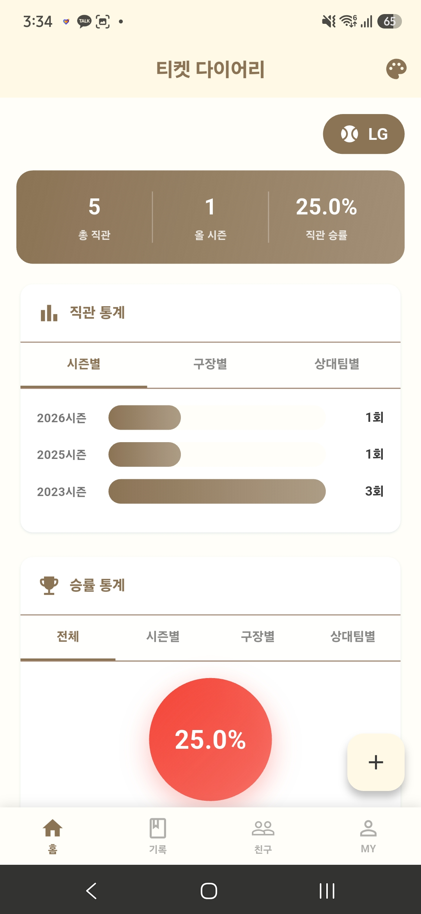
    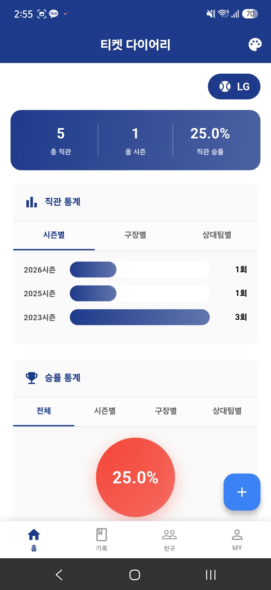
    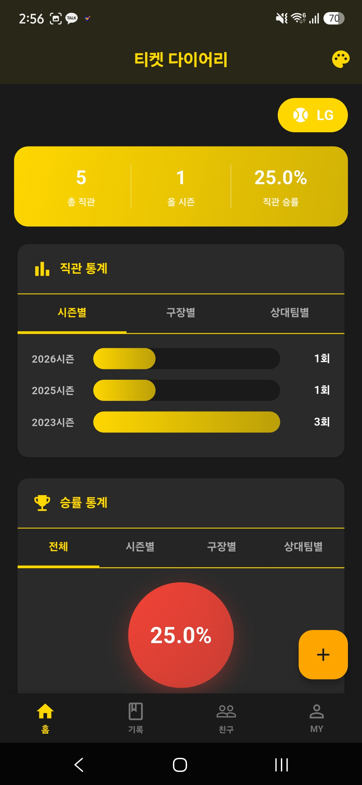
</p>

### 1. 티켓 스캔 & OCR
티켓 사진을 촬영하면 Google ML Kit OCR로 경기 정보를 자동 추출합니다.
- 경기 일정 정보
- 경기 팀 정보
- 경기 구장 정보
- 관람 좌석 정보

<!--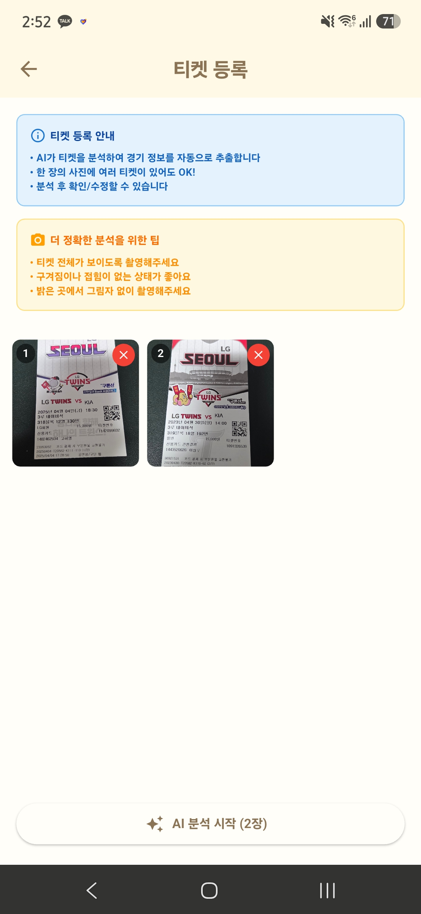
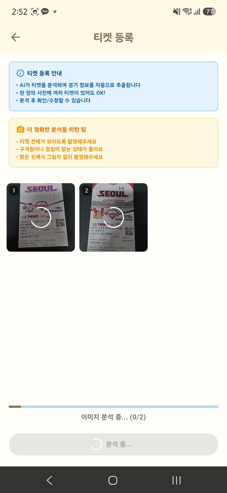
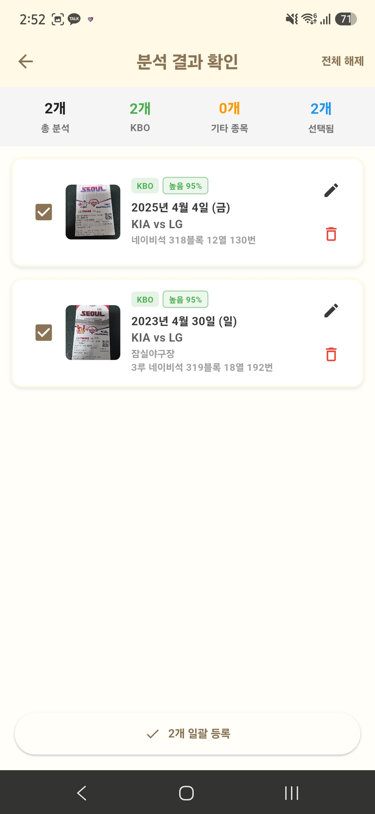
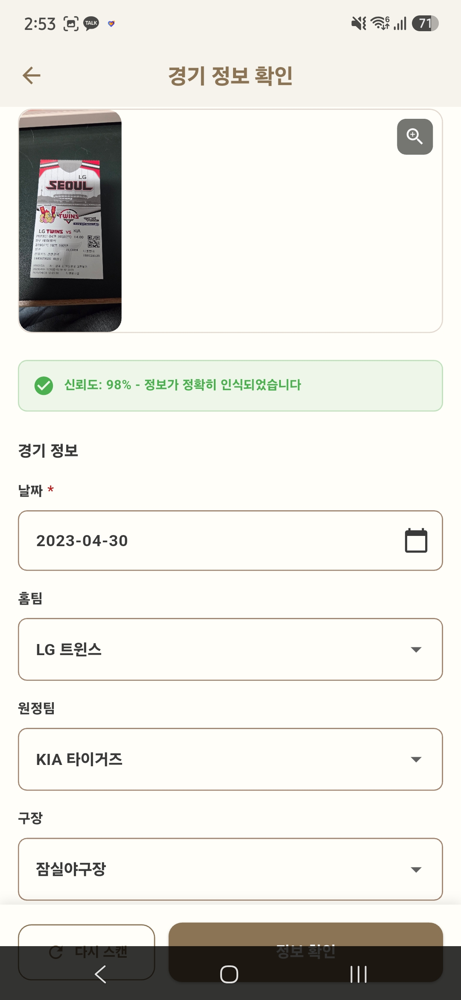 -->
<p>
    
    
    
    
</p>

### 2. 관람 기록 작성
추출된 정보를 기반으로 관람 기록을 작성합니다.
- 추가 사진 (최대 10장)
- 본문 작성
- 해시태그
- 별점 (경기 만족도)

<p>
    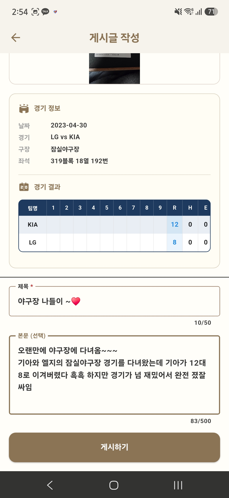
    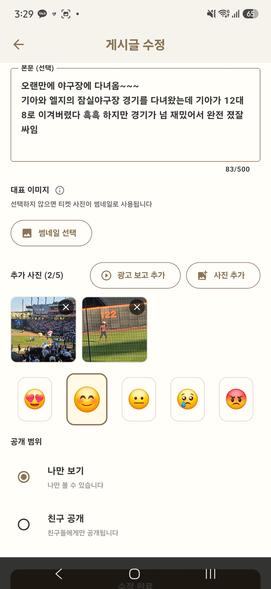
    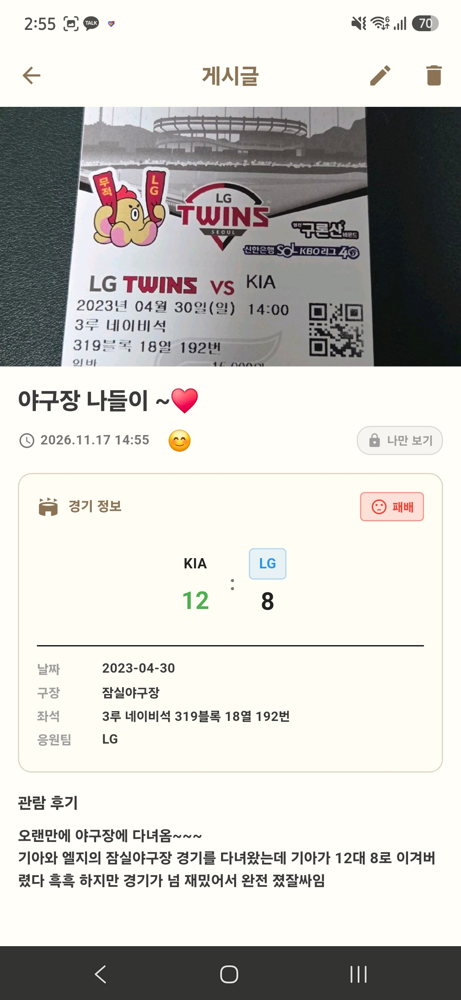
    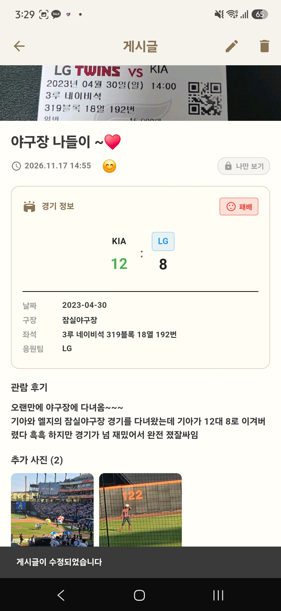
</p>


### 3. 내 아카이브
다양한 뷰로 관람 기록을 확인할 수 있습니다.
- **캘린더 뷰**: 월별 관람 기록 시각화
- **그리드 뷰**: 티켓 이미지 타일
- **리스트 뷰**: 날짜순 타임라인

**필터링 기능**
- 응원팀별 / 구장별 / 연도별 필터
- 복합 필터 지원

<p>
    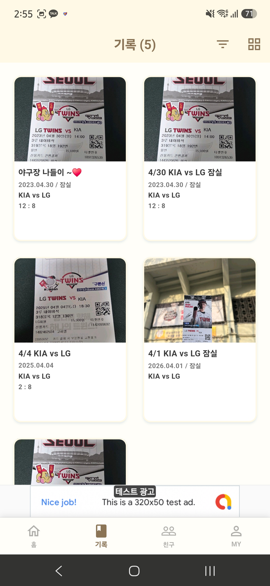
    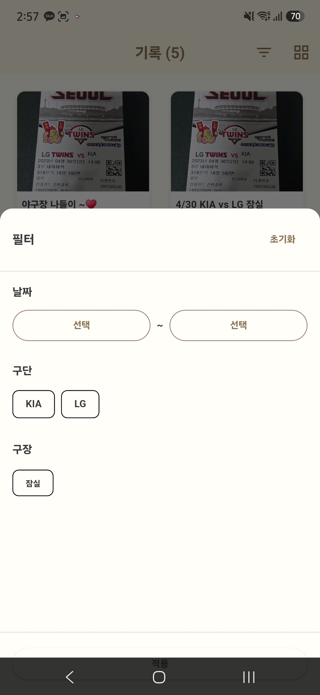
    
</p>

### 4. 소셜 기능
- 친구 검색 및 추가
- 개별 게시글 공유
- **공유 아카이브**: 친구와 함께 본 경기 모아보기

<p>
    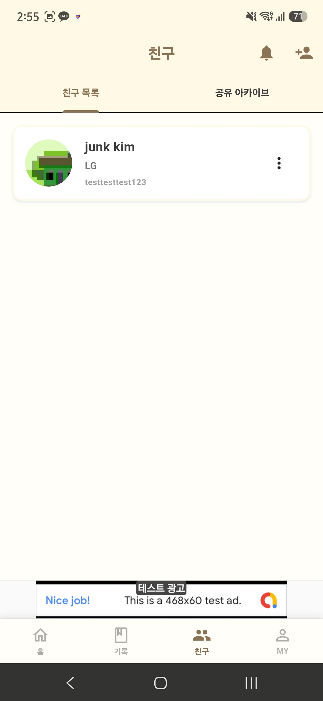
</p>

## 🏗 아키텍처

```
lib/
├── main.dart
├── app.dart
├── core/
│   ├── config/          # 환경 설정
│   ├── constants/       # 상수 (색상, 테마, 팀 데이터)
│   ├── di/              # 의존성 주입 (get_it)
│   ├── exceptions/      # 커스텀 예외
│   ├── routes/          # 라우팅 (go_router)
│   └── utils/           # 유틸리티 함수
├── models/              # 데이터 모델
├── providers/           # 상태 관리 (Provider)
├── services/            # 비즈니스 로직, Firebase 연동
├── screens/             # 화면 (Feature별 분리)
│   ├── auth/
│   ├── home/
│   ├── archive/
│   ├── post/
│   ├── friends/
│   ├── profile/
│   └── settings/
└── widgets/             # 재사용 위젯
    ├── common/
    ├── post/
    └── scoreboard/
```

### 데이터 흐름

```
[UI Layer]
    ↓ 이벤트
[Provider (상태 관리)]
    ↓ 호출
[Service Layer (비즈니스 로직)]
    ↓ 요청
[Firebase (Firestore/Storage/Auth)]
```

## 💡 기술적 의사결정

### 1. Flutter 선택
- **크로스 플랫폼**: 하나의 코드베이스로 iOS/Android 동시 개발
- **네이티브급 성능**: Dart → Native 컴파일로 OCR, 이미지 처리에 적합
- **Hot Reload**: 빠른 개발 사이클

### 2. Firebase 선택
- **통합 솔루션**: Auth, DB, Storage, FCM을 하나의 SDK로 관리
- **실시간 동기화**: Firestore 실시간 리스너로 친구 기능 구현
- **빠른 MVP 개발**: 백엔드 서버 구축 없이 바로 개발 가능
- **비용**: 무료 티어로 MVP 운영 가능

### 3. Provider + get_it 조합
- **Provider**: Flutter 팀 권장, 간단한 상태 관리
- **get_it**: 서비스 로케이터 패턴으로 의존성 주입
- 복잡한 상태 관리 라이브러리(Bloc, Riverpod) 대신 간단한 구조 선택

### 4. Google ML Kit OCR
- **온디바이스 처리**: 서버 비용 없음, 오프라인 가능
- **충분한 인식률**: 한글 티켓 인식에 충분한 성능

## 🔧 트러블슈팅

### 1. OCR 인식률 개선
**문제**: 다양한 티켓 디자인으로 인해 OCR 인식률이 일정하지 않음

**해결**:
- 이미지 전처리 로직 추가 (밝기, 대비 보정)
- 팀별 티켓 패턴 분석 후 파싱 로직 최적화
- 인식 실패 시 수동 입력 폴백 UI 제공
- 극적인 인식률 향상을 위한 AI api 적용 (Gemeni API)

### 2. Firebase 쿼리 최적화
**문제**: 아카이브 필터링 시 복합 쿼리로 인한 인덱스 에러

**해결**:
- Firestore 복합 인덱스 설계 및 생성
- 클라이언트 사이드 필터링과 서버 사이드 쿼리 분리
- 페이지네이션 적용으로 초기 로딩 최적화

### 3. 이미지 용량 관리
**문제**: 원본 이미지 업로드 시 Storage 비용 및 로딩 속도 문제

**해결**:
- flutter_image_compress로 업로드 전 압축 (품질 80%, 최대 1080px)
- cached_network_image로 클라이언트 캐싱
- Storage 규칙으로 최대 파일 크기 제한

## 📝 한계점

### 정식출시 실패 이유
| 항목 | 설명 |
|------|------|
| 모바일 티켓 | 티켓사 모바일 티켓 화면 캡쳐 기능 제한 |
| BM 검증 | 명확한 수익모델 미확립으로 손익 분석 불가 |

### 향후 개선 계획
- 개발자 테스트 결과를 토대로 프로세스 및 UI 개선
- AI API, Google AdMob 등 비용/수익 관련 전반 재검토
- MLB 공식 API를 참고하여 데이터 구조 재설계 및 데이터 검토 방안 마련

## 📎 링크

- **GitHub**: https://github.com/junnnn-k/yozumticket
<!-- - **Play Store**: (출시 예정) -->
<!-- - **시연 영상**: (준비 중) -->

---

## 실행 방법

```bash
# 의존성 설치
flutter pub get

# 개발 모드 실행
flutter run

# 릴리스 빌드 (Android)
flutter build apk --release
```

### 환경 설정
- Flutter SDK 3.10.1 이상
- Firebase 프로젝트 설정 필요 (`firebase_options.dart`)
- Google Services 설정 (`google-services.json`)
